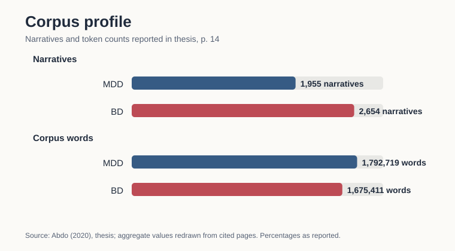
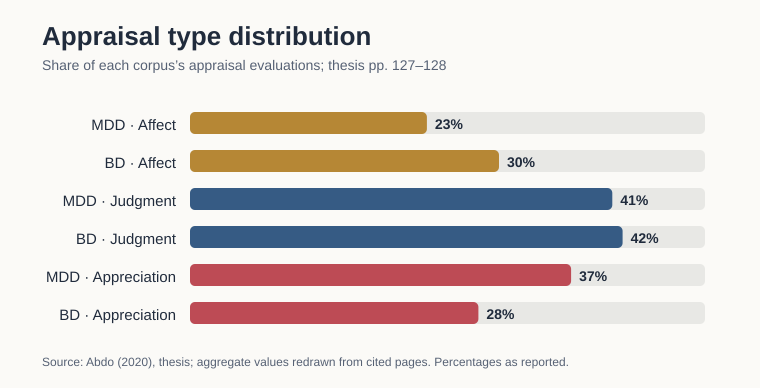
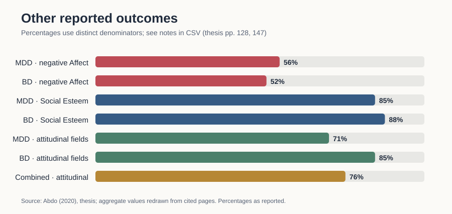

# Depression Narratives: Major Depression and Bipolar Disorder

## Key thesis results

The thesis analyzed **1,955 MDD narratives (1.79M words)** and **2,654 BD narratives (1.68M words)**. Its main appraisal results are summarized here so they appear immediately on the repository landing page:

- **Judgment** was the largest appraisal category in both corpora: 41% MDD and 42% BD. **Appreciation** was 37% MDD and 28% BD; **Affect** was 23% MDD and 30% BD (thesis pp. 127–128; rounded values).
- Negative emotions were 56% of MDD and 52% of BD Affect evaluations. Social Esteem made up 85% of MDD and 88% of BD Judgment evaluations (p. 128).
- Attitudinal syntactic fields were reported at 71% for MDD and 85% for BD (76% combined; pp. 146–147).

### Figures

### Reading the patterns

The thesis uses **Appraisal Theory** to study three kinds of evaluation: **Affect** (emotional responses), **Judgment** (evaluations of people and behavior), and **Appreciation** (evaluations of things, experiences, and situations). Judgment is the largest category in both sets of narratives. The balance of the other two categories differs: MDD narratives contain a larger share of Appreciation, while BD narratives contain a larger share of Affect. These are contrasts in the analyzed texts, not measures of symptom severity or differences between all people with either diagnosis.

Judgment is concentrated in **Social Esteem**—85% of MDD and 88% of BD Judgment evaluations. The thesis identifies Capacity as the most prominent Judgment subcategory, with Propriety also prominent, and reports more positive than negative Judgments overall (pp. 128–129). In the thesis’s interpretation, this emphasis reflects how narrators evaluate their own capacities and their relationships with others; it should be read as a pattern in forum language, not as a clinical conclusion.

For Affect, **Pleasure, Misery, and Fear** are the most frequent emotion types in both corpora. The thesis reports negative emotions at 56% for MDD and 52% for BD (p. 128), so positive and negative emotional language both form substantial parts of the narratives. For Appreciation, **Complexity, Valuation, and Quality** are the leading subtypes. Complexity evaluations are often negative; Composition (Balance and Complexity together) accounts for 54% of Appreciation evaluations in MDD and 61% in BD, while Impact is relatively uncommon (4% and 3%; p. 129).

The thesis also examines **syntactic fields of adjectives** as a way to identify appraisal-bearing expressions. It reports attitudinal evaluations in 71% of retrieved fields for MDD and 85% for BD, with 76% overall (pp. 146–147). This adds a linguistic-pattern layer to the semantic categories above; it does not change the corpus-level limits of the study.

**How to interpret these results:** the corpora consist of online narratives with self-reported diagnoses. They are not a representative or clinically verified sample. The thesis notes inconsistent forum formatting and insufficient personal information for demographic analysis (pp. 13–14). The percentages summarize this dataset and should not be generalized to diagnose individuals or estimate how common these experiences are in a wider population.

[Detailed results and thesis information below](#main-results)

This repository contains two collections of forum narratives in which authors self-report a diagnosis of Major Depressive Disorder (MDD) or Bipolar Disorder (BD). They were assembled for Muhammad Sabry Abd-ElHady Abdo’s 2020 MA thesis on appraisal in mental-health forum narratives. The corpus reflects online self-disclosures; the thesis notes that inconsistent forum formatting and limited personal information constrain demographic analysis (thesis, pp. 13–14).

## Thesis

**Abdo, Muhammad Sabry Abd-ElHady. (2020).** *Analyzing Appraisal in Major and Bipolar Depression Patients’ Narratives in Mental Health Forums: A Corpus-based Study.* MA thesis, Ain Shams University. (The thesis lists supervisors affiliated with Ain Shams and Helwan universities.)

- [Read the thesis on ResearchGate](https://www.researchgate.net/publication/406020286_Analyzing_Appraisal_in_Major_and_Bipolar_Depression_Patients_Narratives_in_Mental_Health_Forums_A_Corpus-based_Study)
- [DOI: 10.13140/RG.2.2.15607.18080](https://doi.org/10.13140/RG.2.2.15607.18080)

## Main results

The thesis applies Appraisal Theory, examining Affect, Judgment, and Appreciation in the two corpora. These are descriptive patterns in forum narratives, not clinical findings about people with either diagnosis.

- **Corpus profile (p. 14):** MDD comprises 1,955 narratives and 1,792,719 words; BD comprises 2,654 narratives and 1,675,411 words.
- **Appraisal types (pp. 127–128):** Judgment is the largest category in both corpora (41% MDD; 42% BD). Appreciation is more frequent in MDD (37% vs. 28% BD), while Affect is more frequent in BD (30% vs. 23% MDD). Percentages are reproduced as reported and may not total 100 due to rounding.
- **Emotion polarity and Social Esteem (p. 128):** Negative emotions account for 56% of MDD and 52% of BD Affect evaluations. Social Esteem accounts for 85% of MDD and 88% of BD Judgment evaluations.
- **Adjective-field evaluation (pp. 146–147):** 71% of MDD and 85% of BD retrieved syntactic fields were labeled attitudinal; the combined rate is reported as 76% (24% Not Applicable).
- **Interpretive summary (pp. 147–148):** Capacity and Propriety are prominent Judgment subcategories. Pleasure, Misery, and Fear are the most frequent emotion types in both corpora. Complexity, Valuation, and Quality are prominent Appreciation subtypes.

## Figures and data

The figures below redraw aggregate values reported in the thesis. They are not new analyses of the underlying narratives. Source values and thesis page references are in [`results/thesis-summary.csv`](results/thesis-summary.csv); regenerate the SVGs with [`figures/create_figures.py`](figures/create_figures.py).

- [Corpus profile](figures/corpus-profile.svg)
- [Appraisal type distribution](figures/appraisal-types.svg)
- [Additional reported outcomes](figures/additional-outcomes.svg)

The charts use only thesis-reported aggregates. No individual forum posts or quotations are reproduced in the figures.

## Citation

For the thesis, cite:

> Abdo, M. S. A. (2020). *Analyzing Appraisal in Major and Bipolar Depression Patients’ Narratives in Mental Health Forums: A Corpus-based Study* [MA thesis, Ain Shams University]. https://doi.org/10.13140/RG.2.2.15607.18080

For the corpora, cite:

> Abdo, M. (2020). *Analyzing Appraisal in Major and Bipolar Depression Patients’ Narratives in Mental Health Forums: A Corpus-based Study* (MA). Ain Shams University.
